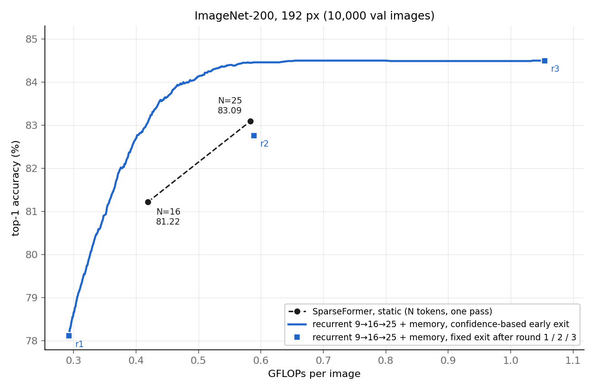
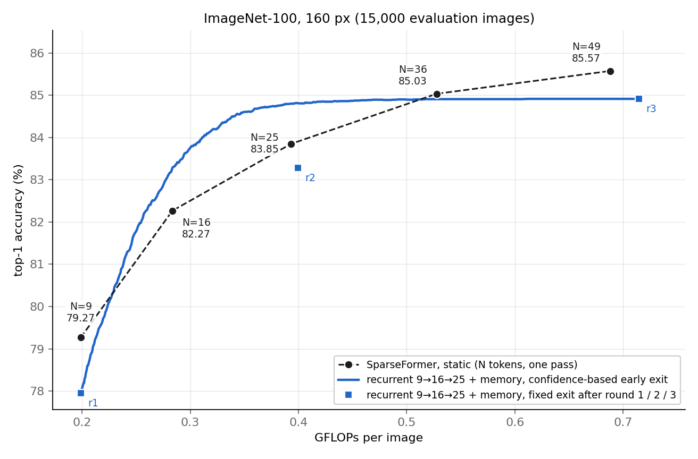

# Active sparse perception

Recurrent sparse vision models that look at an image in rounds. Each round adds a small
set of latent tokens that gather new evidence from the image, a memory carries what the
earlier rounds found, and every round ends with a prediction, so inference can stop as
soon as the model is confident. Easy images use one or two rounds; hard ones use all of
them.

The model is built on [SparseFormer](https://github.com/showlab/sparseformer) [1]. This
repository contains the model, the training and evaluation code, and the results of the
first version (v1) on two ImageNet-1K subsets.

<p align="center">
  
</p>

## Model

A single conv stem computes a feature map once per image; all rounds read from it.

* **Rounds.** Round *r* instantiates its own grid of latent tokens (9, then 16, then 25),
  each with a learned embedding and a learned initial box, initialised as a non-overlapping
  tiling of the image. In the Focus stage the tokens attend to each other, adjust their
  boxes and read 36 points each from the feature map by bilinear sampling (4 iterations,
  width 192).
  They are then lifted to width 384 and processed by the cortex blocks.
* **Memory.** Nothing is carried between rounds except the previous round's cortex output
  `M = H_{r-1}`. The new tokens read it with one cross-attention, inserted before a chosen
  cortex block; a linear encoding `p(.)` of each token's box is added to the queries and
  keys, so the new tokens can address the old ones by where they looked:

  ```
  Z_r = V_r + a * CrossAttn( LN(V_r + p(R_r)),  LN(M + p(R_{r-1})),  LN(M) )
  ```

  `a` is a learned scalar initialised to 1.
* **Exits.** A classifier head shared by all rounds reads the tokens after every round.
  Training supervises all exits: `L = CE(z_last) + 0.1 * mean_r CE(z_r)` over the earlier
  rounds. At inference an image stops at the first round whose top softmax probability
  reaches a threshold; sweeping the threshold trades accuracy for compute.

With a single round and no memory the model is a static SparseFormer. That is the
baseline in every comparison below: the same implementation and training recipe with
one round of N tokens, not the released SparseFormer checkpoints.

## Results (v1)

All models are trained from scratch for 200 epochs with the same recipe (see
[Training](#training)). GFLOPs are fvcore counts at the evaluation resolution, where one
multiply-add counts as one FLOP. For early exit they are averaged over the evaluation
set, and an image that stops after round *r* pays for the stem and rounds 1..*r*. All
numbers come from a single training run per model; `results/` holds the per-model
evaluations that the tables and figures are generated from.

### ImageNet-200 (192 px, 10,000 val images)

| Model | Tokens | GFLOPs | Top-1 (%) |
|---|---|---:|---:|
| SparseFormer, static | 16 | 0.419 | 81.22 |
| SparseFormer, static | 25 | 0.583 | 83.09 |
| Recurrent + memory, exit after round 1 | 9 | 0.292 | 78.11 |
| Recurrent + memory, exit after round 2 | 9 → 16 | 0.589 | 82.76 |
| Recurrent + memory, exit after round 3 | 9 → 16 → 25 | 1.054 | 84.50 |
| Recurrent + memory, early exit | adaptive | 0.418 | **83.05** |
| Recurrent + memory, early exit | adaptive | 0.421 | 83.13 |
| Recurrent + memory, early exit | adaptive | 0.579 | **84.46** |
| Recurrent + memory, early exit | adaptive | 0.654 | 84.50 |
| Recurrent, no memory, exit after round 3 (ablation) | 9 → 16 → 25 | 1.034 | 83.70 |

* At the cost of the static 16-token model, early exit is 1.83 points more accurate
  (83.05 vs 81.22). The static 25-token accuracy (83.09) is reached at 0.421 GFLOPs,
  28% less compute, and at the static 25-token cost the recurrent model reaches 84.46
  (+1.37).
* The accuracy of running all three rounds (84.50) is reached at 0.654 GFLOPs on
  average, 38% below the 1.054 GFLOPs of always running them.
* Without the memory (the rounds share weights but do not communicate) the last exit
  drops from 84.50 to 83.70 and round 2 from 82.76 to 81.87, while round 1 is slightly
  better (79.24 vs 78.11). Early exit then gives 82.59 at the static-16 cost and 83.69
  at the static-25 cost.

### ImageNet-100 (160 px, 15,000 evaluation images)

The evaluation set is the 5,000 val images plus 100 held-out train images per class;
those 10,000 images are removed from training. The cortex has 3 blocks here (5 on
ImageNet-200).

<p align="center">
  
</p>

| Model | Tokens | GFLOPs | Top-1 (%) |
|---|---|---:|---:|
| SparseFormer, static | 9 | 0.199 | 79.27 |
| SparseFormer, static | 16 | 0.283 | 82.27 |
| SparseFormer, static | 25 | 0.393 | 83.85 |
| SparseFormer, static | 36 | 0.528 | 85.03 |
| SparseFormer, static | 49 | 0.688 | 85.57 |
| Recurrent + memory, exit after round 1 | 9 | 0.199 | 77.95 |
| Recurrent + memory, exit after round 2 | 9 → 16 | 0.399 | 83.28 |
| Recurrent + memory, exit after round 3 | 9 → 16 → 25 | 0.715 | 84.91 |
| Recurrent + memory, early exit | adaptive | 0.283 | **83.23** |
| Recurrent + memory, early exit | adaptive | 0.306 | 83.86 |
| Recurrent + memory, early exit | adaptive | 0.393 | **84.80** |

* Early exit is about one point more accurate than the static models at the cost of 16
  and of 25 tokens (+0.96, +0.95) and reaches the static 25-token accuracy with 22% less
  compute.
* The recurrent model saturates at 84.91. Above about 0.5 GFLOPs the static models with
  36 and 49 tokens are more accurate (85.03, 85.57), so on this smaller cortex the gain
  is confined to the low and medium compute range.
* Round 1 is 1.3 points below a static 9-token model of the same cost (77.95 vs 79.27):
  training the first round jointly with the later ones costs it some accuracy.

## Training

```bash
pip install -r requirements.txt     # tested with Python 3.10, PyTorch 2.5, timm 1.0
```

The two datasets are subsets of ImageNet-1K; the class lists are in `data/splits/`.
ImageNet-100 uses the 100 classes of CMC [7], with images stored at 256 px on the
shorter side. ImageNet-200 uses 200 randomly drawn classes at full resolution.

```bash
python tools/make_subset.py --imagenet /data/imagenet --split data/splits/imagenet200.txt \
    --out /data/imagenet200
python tools/make_subset.py --imagenet /data/imagenet --split data/splits/imagenet100.txt \
    --out /data/imagenet100 --short-side 256
```

Training uses `torchrun`; the configs in `configs/` are the ones behind the results above.

```bash
torchrun --nproc_per_node=2 train.py --cfg configs/imagenet200/recurrent_9-16-25_memory.yaml \
    --data-path /data/imagenet200 --output output/imagenet200
torchrun --nproc_per_node=2 train.py --cfg configs/imagenet200/static_n25.yaml \
    --data-path /data/imagenet200 --output output/imagenet200
```

Recipe (shared by all models): AdamW with weight decay 0.05, cosine schedule with linear
warmup, peak learning rate 1e-3 at batch 1024 (ImageNet-100) or 2.5e-4 at batch 512
(ImageNet-200), RandAugment (m9), mixup 0.8 / CutMix 1.0, label smoothing 0.1, random
erasing 0.25, repeated augmentation (3x), drop path 0.2, gradient clipping at 5, mixed
precision. On 2 RTX 4090 GPUs a 200-epoch ImageNet-200 run of the recurrent model takes
about 4.8 hours.

## Evaluation

`tools/eval_exits.py` evaluates a checkpoint at every exit, measures the GFLOPs of each
exit and sweeps the early-exit threshold; `tools/plot_frontier.py` draws the figures from
its output.

```bash
python tools/eval_exits.py --cfg configs/imagenet200/recurrent_9-16-25_memory.yaml \
    --ckpt output/imagenet200/recurrent_9-16-25_memory/final_weights.pth \
    --data-path /data/imagenet200 --out results/imagenet200/recurrent_9-16-25_memory.json
bash scripts/plot_results.sh        # assets/*.png from results/*.json
```

`train.py --eval --resume <checkpoint>` reports the per-exit accuracy with the training
pipeline instead.

## Repository layout

```
models/sparseformer.py   SparseFormer units: conv stem, focus/cortex blocks, sampling, head
models/recurrent.py      rounds, memory read, per-round exits
train.py                 distributed training and evaluation
config.py, configs/      configuration and the configs used for the results
data/                    data pipeline and the dataset class lists
tools/                   exit evaluation, frontier plots, dataset subsets
results/, assets/        evaluation outputs and figures
```

## Next steps

- [ ] ImageNet-1K at 224 px, with the static baselines retrained under the same recipe.
- [ ] Larger models (wider and deeper cortex, more tokens per round), to see whether the
      gap to the static models holds as capacity grows. On ImageNet-100 the recurrent model
      currently saturates below the 36- and 49-token static models.
- [ ] Memory: reads at several cortex depths, gated reads, and a write step that updates
      the memory instead of replacing it after every round.
- [ ] Evidence acquisition: place and size each round's new tokens from what the memory
      holds; today every round starts from its own fixed learned grid.
- [ ] Spatial encoding of token boxes, in the memory read and in self-attention.
- [ ] Per-image compute: learned stopping in place of a single confidence threshold, and
      the number of tokens per round.
- [ ] Efficiency: wall-clock throughput and latency next to FLOPs, a fused kernel for the
      point sampling and mixing step, and multi-node training with a sharded dataset format.
- [ ] Complete the ImageNet-200 baselines (static 9, 36 and 49 tokens) and repeat runs with
      different seeds.

## Related work

1. **SparseFormer.** Z. Gao, Z. Tong, L. Wang, M. Z. Shou. *SparseFormer: Sparse Visual
   Recognition via Limited Latent Tokens.* ICLR 2024.
   [paper](https://arxiv.org/abs/2304.03768) · [code](https://github.com/showlab/sparseformer)
   The base architecture: a small set of latent tokens, each with a box, which sample
   image features sparsely and are processed by a focusing and a cortex transformer.
2. **GFNet.** Y. Wang, K. Lv, R. Huang, S. Song, L. Yang, G. Huang. *Glance and Focus: a
   Dynamic Approach to Reducing Spatial Redundancy in Image Classification.* NeurIPS 2020.
   [paper](https://arxiv.org/abs/2010.05300) · [code](https://github.com/blackfeather-wang/GFNet-Pytorch)
   A glance at a downscaled image, then a sequence of patches chosen by a reinforcement
   learning policy, a recurrent classifier, and a stop once the prediction is confident.
3. **DVT.** Y. Wang, R. Huang, S. Song, Z. Huang, G. Huang. *Not All Images are Worth
   16x16 Words: Dynamic Transformers for Efficient Image Recognition.* NeurIPS 2021.
   [paper](https://arxiv.org/abs/2105.15075)
   A cascade of transformers with increasing numbers of tokens that reuses features and
   relations from the previous stage and exits when confident.
4. **ThinkingViT.** A. Hojjat et al. *ThinkingViT: Matryoshka Thinking Vision Transformer
   for Elastic Inference.* CVPR 2026. [paper](https://arxiv.org/abs/2507.10800)
   A nested ViT that starts with a subset of its attention heads, activates more on
   uncertain inputs, and conditions each stage on the previous stage's embeddings.
5. **RAM.** V. Mnih, N. Heess, A. Graves, K. Kavukcuoglu. *Recurrent Models of Visual
   Attention.* NeurIPS 2014. [paper](https://arxiv.org/abs/1406.6247)
   A recurrent network that takes a sequence of glimpses at locations it chooses.
6. **MSDNet.** G. Huang, D. Chen, T. Li, F. Wu, L. van der Maaten, K. Q. Weinberger.
   *Multi-Scale Dense Networks for Resource Efficient Image Classification.* ICLR 2018.
   [paper](https://arxiv.org/abs/1703.09844)
   Intermediate classifiers for anytime prediction and budgeted classification.
7. **CMC.** Y. Tian, D. Krishnan, P. Isola. *Contrastive Multiview Coding.* ECCV 2020.
   [paper](https://arxiv.org/abs/1906.05849) (source of the ImageNet-100 class list)

## License

MIT, see [LICENSE](LICENSE). The SparseFormer units and parts of the training pipeline
are adapted from [SparseFormer](https://github.com/showlab/sparseformer) and
[Swin Transformer](https://github.com/microsoft/Swin-Transformer), both MIT-licensed;
their notices are kept in the corresponding files.
